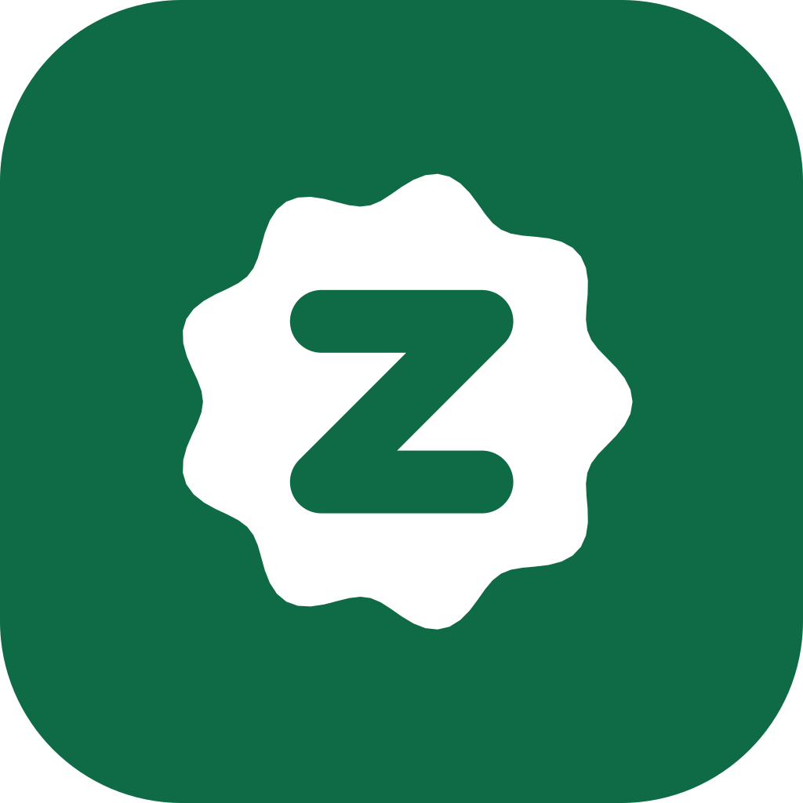
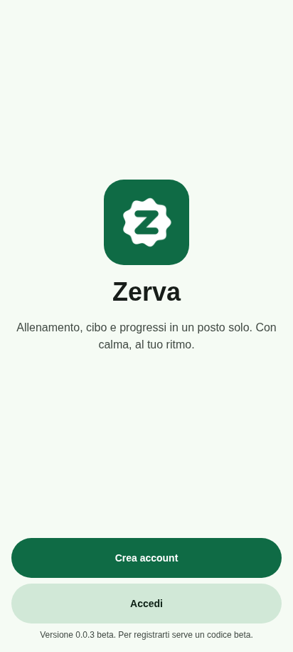
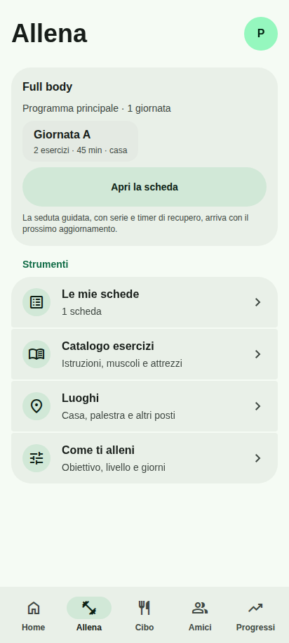
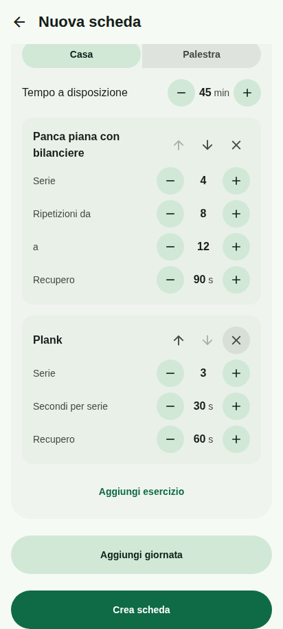
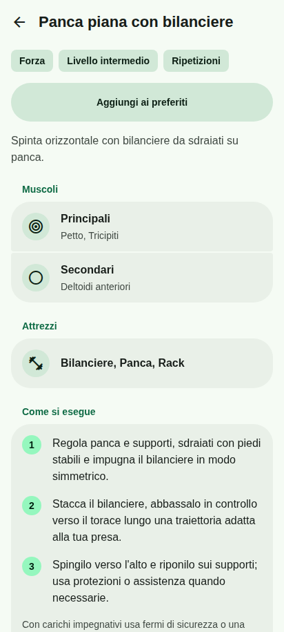
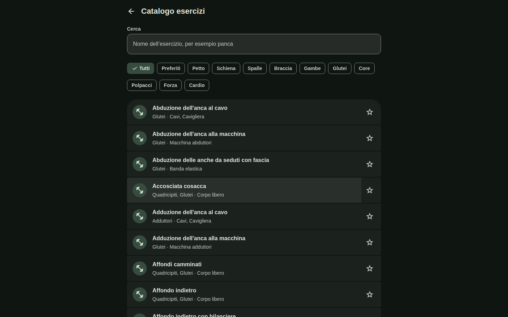

  

<h1 align="center">Zerva</h1>

<strong>Training, food and progress in one place. Calmly, at your own pace.</strong>

  
  
  
  
  
  
  

  <a href="README.md">Italiano</a> · <strong>English</strong>

  <a href="https://zerva.dragolabs.it">Open Zerva on the web</a> ·
  <a href="../../releases">Android releases</a> ·
  <a href="../../issues/new/choose">Report a problem or share an idea</a>

---

Zerva is the **Drago Labs** app that brings together training, nutrition, progress and, if you want, your friends. It runs on Android phones and in the browser, works without a connection, and your data stays private until you choose to share it.

The app is in Italian for now.

  
  
  
  

## What it solves

- **One app for everything.** Gym plans in one app, calories in another, progress in a spreadsheet, friends on a social network. Zerva keeps it all together, and each part also works on its own.
- **Training without a clear plan.** Plans with days, exercises, sets, reps and rest, plus a guided session that tells you what to do and how long to rest.
- **Counting calories as a chore.** The food diary works without targets; calorie range and macros are there only if you want them, and missing data is never treated as zero.
- **Gyms with no signal.** Plans, sessions and the diary work offline and sync as soon as you are back online.
- **Sharing more than you meant to.** Everything is private by default. Social features are optional, and before posting you always see a preview and choose who can see it.
- **Apps that rush you.** No pressure: consistency is measured week by week, with milestones that reward regularity, not excess.

## What the stable version will offer

### Training
- Personal plans with days, place (home or gym), available time, exercises, sets, reps or time and rest; every edit creates a new version and past sessions stay as they were.
- A main program always on top, with the days of the week.
- A catalog of more than 200 exercises with step-by-step instructions, common mistakes, safety notes, muscles, equipment and alternatives; favorites.
- Guided sessions set by set, with last time's loads, a rest timer with vibration and the screen kept awake.
- Session history and progress for each exercise.
- Automatic plan suggestions based on goal, experience, days, place and equipment, enabled only after professional review.
- Importing and sharing plans, and a summary card to download or post after a session.
- Personal places and gyms with their equipment, personal machine settings, private notes.

### Nutrition
- A daily diary split into customizable meals, with water and totals that show how complete the data is.
- Food search, recent items, favorites and barcode scanning; personal foods and private corrections.
- Calorie and macro targets you set yourself, with pause and resume; guided suggestions only after professional review.
- A weekly meal plan with alternatives, confirmed only when you actually eat.
- A recipe book with saved recipes, personal copies and variants, step-by-step cooking with multiple timers, shopping lists.

### Progress and consistency
- Charts of what you log, opening on the last 30 days.
- Body measurements and photos in a private diary, protected by PIN or biometrics if you want.
- Week-by-week consistency, with milestones from Iron to Diamond, and a weekly summary that tells empty days apart.

### Friends, optional
- Profile, feed and posts with an audience chosen every time.
- Circles of friends with events and consistency challenges, leaderboards and milestones.
- Access to your progress only for the people you allow, blocking, and pausing social features at any time.

### Everywhere
- A customizable Home with the cards you need, reminders for training, meals and water, notifications in a single inbox.
- Android and web on phone, tablet and computer; iPhone later.
- Works offline and syncs across devices.
- Light and dark themes, Material 3 Expressive design, haptic feedback, animations that respect reduced motion.
- Automatic updates with release notes in plain words and a short tour of every new feature.
- Control over sessions and devices, data export, and account deletion with seven days to change your mind.

  

## Project status

> [!IMPORTANT]
> **Zerva is in development.** The features above describe the stable version: they arrive one update at a time and some parts may still change.

Today the closed beta includes accounts and sign-in, password recovery, preferences, sessions, in-app feedback, the tour and release notes, and the first part of training: exercise catalog, personal plans, main program, places and the initial questionnaire. Next come guided sessions, the food diary, Home and progress; then the first complete beta.

Signing up requires an invitation code.

## Try it

- **In the browser:** [zerva.dragolabs.it](https://zerva.dragolabs.it), on phone, tablet or computer.
- **On Android:** download the APK from the [releases page](../../releases), open it on your phone and allow installs from that source when Android asks. Later updates arrive inside the app.
- **iPhone:** not available yet.

## Releases

Only **approved** versions are published here, starting from the first complete beta. Each release has its notes and the file's SHA-256 fingerprint, so you can check the APK is the original one.

## Feedback

Found a problem or have an idea? [Open an issue](../../issues/new/choose), or use «Invia feedback» inside the app. Do not include passwords, codes received by email or other personal data.

For a security problem do not open a public issue: follow [SECURITY.md](SECURITY.md).

## Rights

© Drago Labs. All rights reserved. The source code is not public; texts, images and the brand in this repository may not be reused without permission. Details in [LICENSE](LICENSE).
