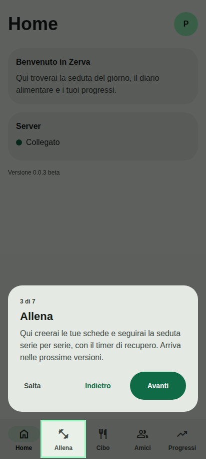
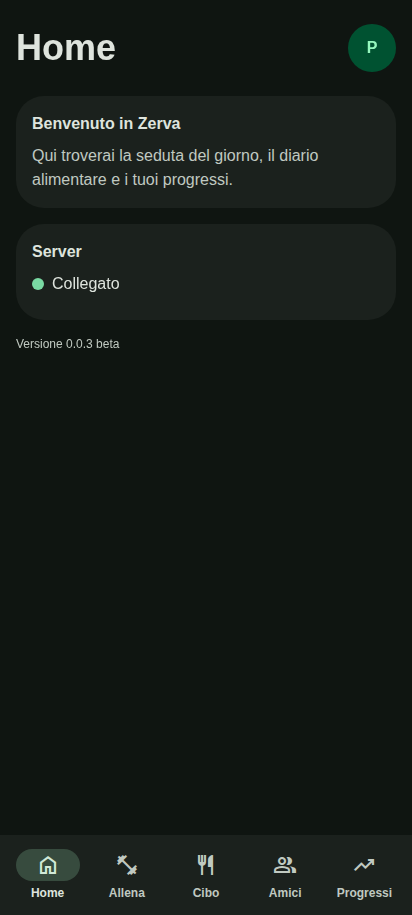
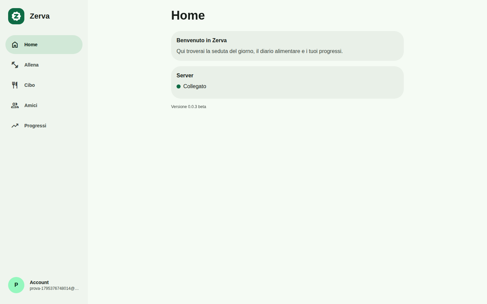

  

<h1 align="center">Zerva</h1>

Allenamento, cibo e progressi in un posto solo. Con calma, al tuo ritmo.

  <a href="https://zerva.dragolabs.it"><strong>Apri Zerva sul web</strong></a> ·
  <a href="../../releases">Versioni per Android</a> ·
  <a href="../../issues/new/choose">Segnala un problema o un'idea</a>

---

Zerva è un'app di Drago Labs per seguire i propri allenamenti, quello che si mangia e i progressi nel tempo, senza fretta e senza pressioni. È in **beta chiusa**: per registrarsi serve un codice d'invito.

Questo repository è la pagina pubblica del progetto: presentazione, versioni approvate e segnalazioni. Il codice sorgente non è pubblico.

  
  
  

## Cosa c'è oggi

Zerva è all'inizio. Per ora puoi:

- creare un account con il codice d'invito, verificare l'email e accedere;
- seguire una breve guida che mostra dove trovi le cose;
- leggere le novità di ogni versione, che arrivano da sole senza reinstallare l'app;
- usarla sul telefono Android o dal browser, anche su tablet e computer.

Le sezioni Allena, Cibo, Amici e Progressi sono già al loro posto e si riempiono versione dopo versione.

  

## Dove sta andando

La prima beta completa conterrà:

- **Allenamento:** schede personali, seduta guidata serie per serie con timer di recupero, diario delle sedute.
- **Cibo:** diario dei pasti e obiettivi scelti da te.
- **Progressi:** andamento nel tempo e costanza settimana dopo settimana.

Più avanti arriveranno la parte social, che resta facoltativa, e le proposte automatiche di allenamento e alimentazione, solo dopo la revisione di professionisti.

## Come provarla

- **Dal browser:** [zerva.dragolabs.it](https://zerva.dragolabs.it), su telefono, tablet o computer.
- **Su Android:** scarica l'APK dalla [pagina delle versioni](../../releases), aprilo sul telefono e consenti l'installazione da quella fonte quando Android lo chiede. Le versioni successive arrivano da sole dentro l'app.
- **iPhone:** non ancora disponibile.

Per entrare serve un codice d'invito alla beta.

## Versioni

Qui escono solo le versioni **approvate**, a partire dalla prima beta completa. Ogni versione ha le sue note e l'impronta SHA-256 del file, per controllare che l'APK sia quello originale.

## Segnalazioni

Hai trovato un problema o hai un'idea? [Apri una segnalazione](../../issues/new/choose): bastano poche righe su cosa stavi facendo e cosa è successo. Non scrivere password, codici ricevuti per email o altri dati personali.

Per un problema di sicurezza non aprire una segnalazione pubblica: segui le indicazioni in [SECURITY.md](SECURITY.md).

## Diritti

© Drago Labs. Tutti i diritti riservati. Testi, immagini e marchio di questo repository non si possono riusare senza autorizzazione; i dettagli sono in [LICENSE](LICENSE).
