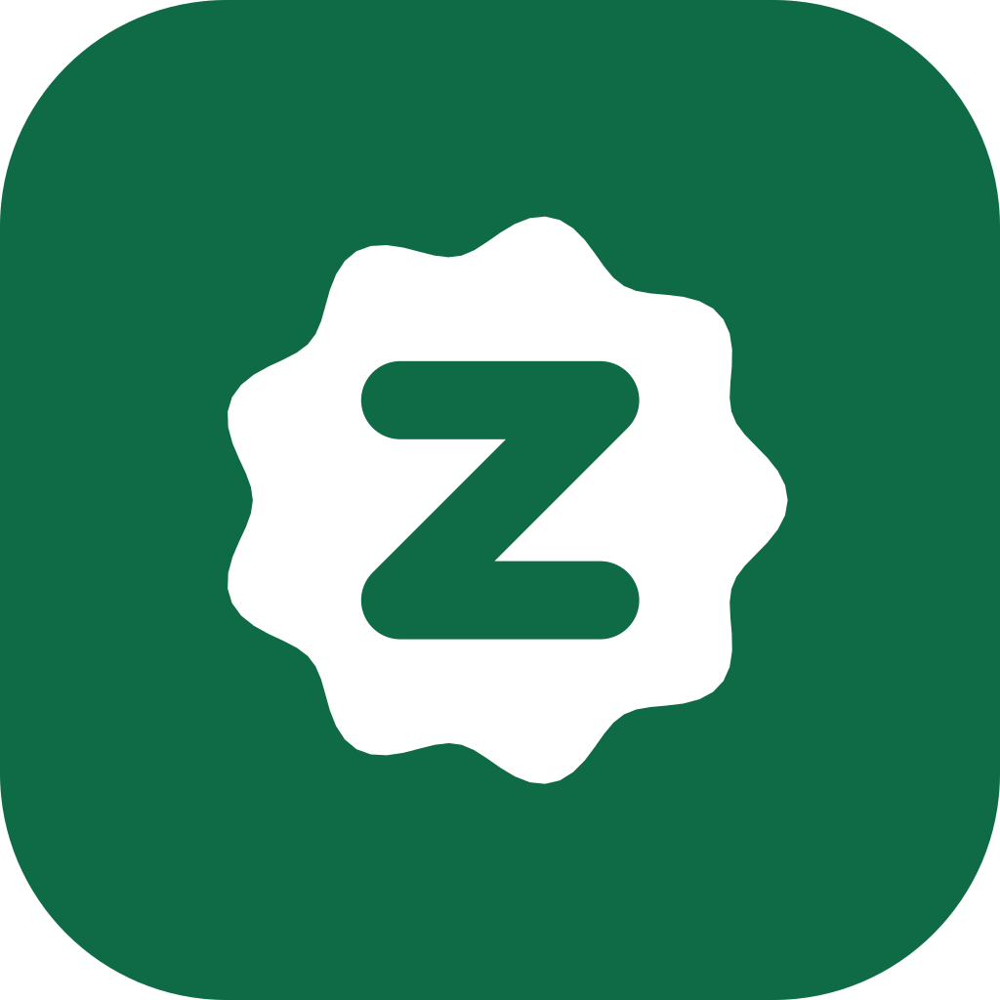
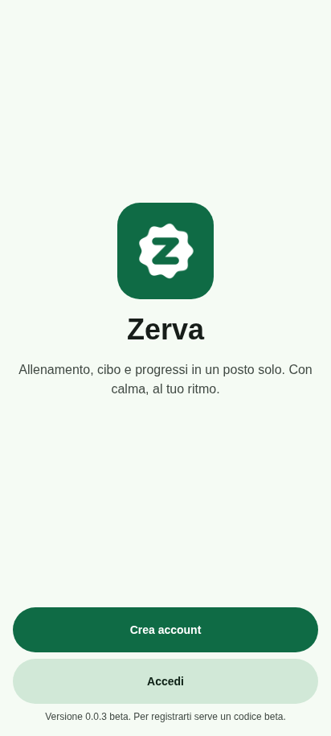
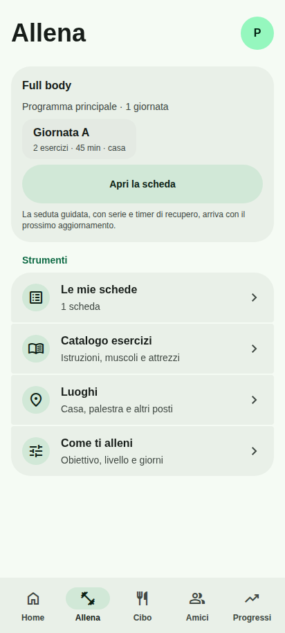
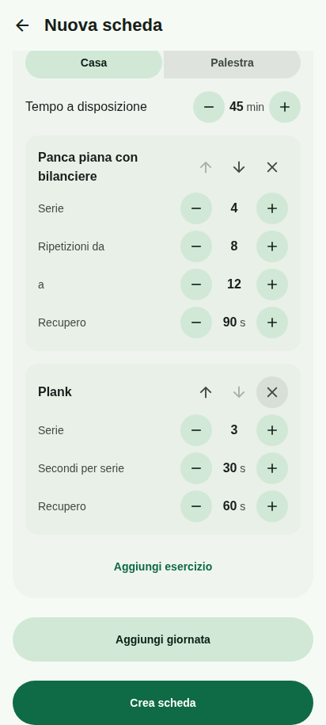
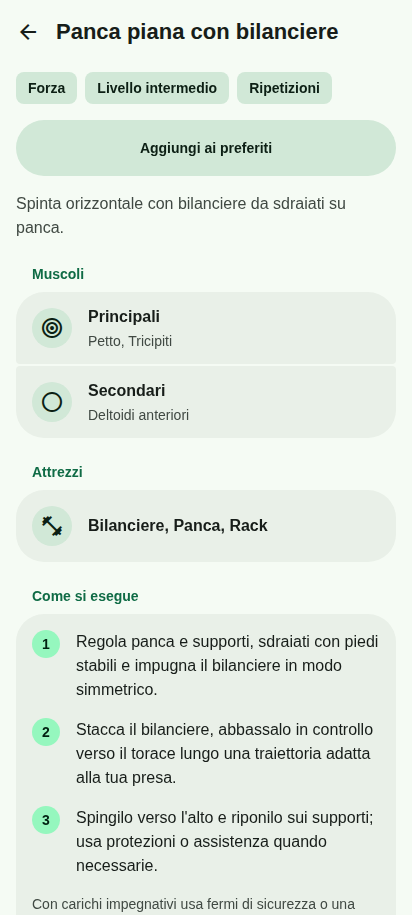
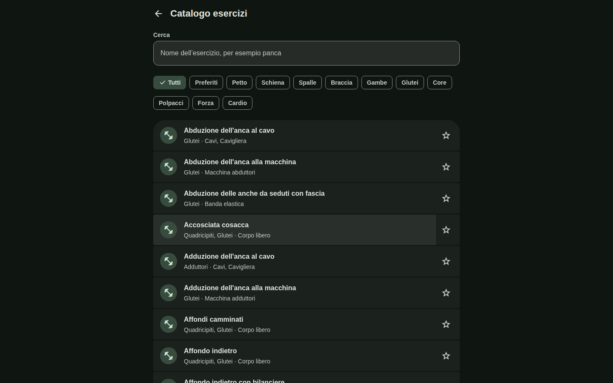

  

<h1 align="center">Zerva</h1>

<strong>Allenamento, cibo e progressi in un posto solo. Con calma, al tuo ritmo.</strong>

  
  
  
  
  
  
  

  <strong>Italiano</strong> · <a href="README.en.md">English</a>

  <a href="https://zerva.dragolabs.it">Apri Zerva sul web</a> ·
  <a href="../../releases">Versioni per Android</a> ·
  <a href="../../issues/new/choose">Segnala un problema o un'idea</a>

---

Zerva è l'app di **Drago Labs** che mette insieme allenamento, alimentazione, progressi e, se vuoi, gli amici. Funziona sul telefono Android e dal browser, anche senza rete, e i tuoi dati restano privati finché non scegli tu di condividerli.

  
  
  
  

## Quali problemi risolve

- **Un'app per ogni cosa.** Scheda in palestra su un'app, calorie su un'altra, progressi su un foglio, amici su un social. Zerva tiene tutto insieme, e ogni parte funziona anche da sola.
- **Allenarsi senza un piano chiaro.** Schede con giornate, esercizi, serie, ripetizioni e recupero, e una seduta guidata che ti dice cosa fare e quanto riposare.
- **Contare le calorie come un obbligo.** Il diario funziona anche senza obiettivi; fascia calorica e macro si attivano solo se li vuoi, e un dato mancante non viene mai scambiato per zero.
- **Palestre senza campo.** Schede, sedute e diario si usano anche offline e si sincronizzano appena torna la rete.
- **Condividere più del necessario.** Tutto è privato di base. Il social è facoltativo e prima di pubblicare vedi sempre un'anteprima e scegli chi può vedere.
- **App che mettono fretta.** Niente pressioni: costanza misurata settimana per settimana, con traguardi che premiano la regolarità e non l'eccesso.

## Cosa offrirà la versione stabile

### Allenamento
- Schede personali con giornate, luogo (casa o palestra), tempo a disposizione, esercizi, serie, ripetizioni o tempo e recupero; ogni modifica crea una nuova versione e le sedute passate restano com'erano.
- Programma principale sempre in cima, con le giornate della settimana.
- Catalogo di oltre 200 esercizi con istruzioni passo passo, errori comuni, sicurezza, muscoli coinvolti, attrezzi e alternative; preferiti.
- Seduta guidata serie per serie, con carichi della volta precedente, timer di recupero con vibrazione e schermo sempre acceso.
- Cronologia delle sedute e progressi per esercizio.
- Proposta automatica di schede in base a obiettivo, esperienza, giorni, luogo e attrezzi, attivata solo dopo la revisione di professionisti.
- Importazione e condivisione di schede, card riassuntiva da scaricare o pubblicare a fine seduta.
- Luoghi personali e palestre con la loro attrezzatura, impostazioni personali delle macchine, note private.

### Alimentazione
- Diario del giorno diviso in pasti personalizzabili, con acqua e totali che mostrano quanto i dati sono completi.
- Ricerca degli alimenti, recenti, preferiti e lettura del codice a barre; alimenti personali e correzioni per uso privato.
- Obiettivi di calorie e macro scelti da te, con pausa e ripresa; proposta guidata solo dopo revisione professionale.
- Piano pasti settimanale con alternative, da confermare quando mangi davvero.
- Ricettario con ricette salvate, copie personali e varianti, preparazione passo passo con più timer, liste della spesa.

### Progressi e costanza
- Grafici delle metriche registrate, aperti sugli ultimi 30 giorni.
- Misure e foto del corpo in un diario privato, protetto da PIN o biometria se vuoi.
- Costanza settimana dopo settimana, con traguardi dal Ferro al Diamante, e un riepilogo settimanale che distingue i giorni senza dati.

### Amici, facoltativo
- Profilo, feed e post con un pubblico scelto ogni volta.
- Cerchie di amici con eventi e gare di costanza, classifiche e traguardi.
- Accesso ai tuoi progressi solo a chi lo concedi, blocchi e pausa del social in ogni momento.

### Ovunque
- Home personalizzabile con le schede che ti servono, promemoria per allenamento, pasti e acqua, notifiche in un'unica casella.
- Android, web su telefono, tablet e computer; iPhone più avanti.
- Funziona offline e si sincronizza tra i dispositivi.
- Tema chiaro e scuro, design Material 3 Expressive, vibrazione ai tocchi, animazioni che rispettano il movimento ridotto.
- Aggiornamenti automatici con le novità spiegate in parole semplici e una guida per ogni funzione nuova.
- Sessioni e dispositivi sotto controllo, esportazione dei dati e cancellazione dell'account con sette giorni per ripensarci.

  

## Stato del progetto

> [!IMPORTANT]
> **Zerva è in sviluppo.** Le funzioni elencate sopra descrivono la versione stabile: arrivano un aggiornamento dopo l'altro e alcune parti possono ancora cambiare.

Oggi la beta chiusa comprende account e accesso, recupero della password, preferenze, sessioni, invio di feedback, guida e novità, e la prima parte dell'allenamento: catalogo esercizi, schede personali, programma principale, luoghi e questionario iniziale. Le prossime tappe sono la seduta guidata, il diario alimentare, la Home e i progressi; poi la prima beta completa.

Per registrarsi serve un codice d'invito.

## Come provarla

- **Dal browser:** [zerva.dragolabs.it](https://zerva.dragolabs.it), su telefono, tablet o computer.
- **Su Android:** scarica l'APK dalla [pagina delle versioni](../../releases), aprilo sul telefono e consenti l'installazione da quella fonte quando Android lo chiede. Gli aggiornamenti successivi arrivano da soli dentro l'app.
- **iPhone:** non ancora disponibile.

## Versioni

Qui escono solo le versioni **approvate**, a partire dalla prima beta completa. Ogni versione ha le sue note e l'impronta SHA-256 del file, per controllare che l'APK sia quello originale.

## Segnalazioni

Hai trovato un problema o hai un'idea? [Apri una segnalazione](../../issues/new/choose), oppure usa «Invia feedback» dentro l'app. Non scrivere password, codici ricevuti per email o altri dati personali.

Per un problema di sicurezza non aprire una segnalazione pubblica: segui le indicazioni in [SECURITY.md](SECURITY.md).

## Diritti

© Drago Labs. Tutti i diritti riservati. Il codice sorgente non è pubblico; testi, immagini e marchio di questo repository non si possono riusare senza autorizzazione. I dettagli sono in [LICENSE](LICENSE).
